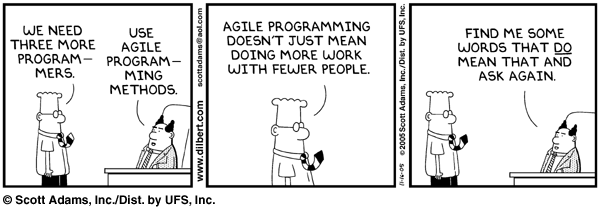

Hola a tod@s,

he visto esta viñeta y me ha parecido interesante ponerla en mi blog ... Este pobre Dilbert sufre de todo, incluso con la metodología Agile !  <!--more-->

Por cierto, he investigado mínimamente y ... Dilbert tiene 18 añitos, ya es mayor de edad !!!

Para quien quiera saber más : [http://es.wikipedia.org/wiki/Dilbert](http://es.wikipedia.org/wiki/Dilbert)

[Versión española](http://espanol.dilbert.com/), y [versión inglesa](http://www.dilbert.com/) de las páginas de Dilbert.
