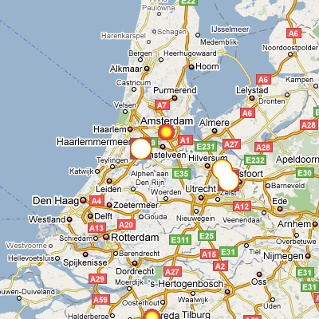

At [dooplan](http://www.dooplan.com) we have implemented [gheat](http://code.google.com/p/gheat/) in django.

Gheat is a simple system heat maps to show in a google map.

<!--more-->It normally works with an external and WSGI  compliant server (named [aspen](http://www.zetadev.com/software/aspen/)), but we want to have it inside our infraestructure, both in development (just django development server) as well as in our production server. So we have made a port from normal python gheat to django gheat.

I have published it on github : http://github.com/robertrv/django-gheat/tree/master

I will post a extend tutorial on how to customize it, but for now if you want to use it (having installed [django](http://www.djangoproject.com/) and [git](http://git-scm.com/)) you can do the following instructions

> git clone git://github.com/robertrv/django-gheat.git
> 
> cd django-gheat/samples/persisted/
> 
> python manage.py runserver

then go to your browser on http://127.0.0.1:8000/home/ and you will see something like:

You can also see the live effect in dooplan, where we show which are the ["hot" places](http://www.dooplan.com/places/list/) in barcelona or madrid.
