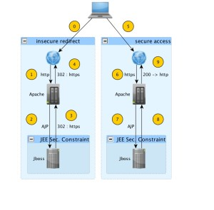
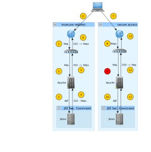
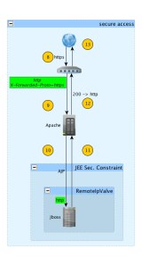

We have had a problem with a proxy and some secure connections throw apache-jboss, more precisely ELB from Amazon Web Service (Elastic Load Balancer).

Our scenario was previously just an apache sending requests to Jboss, and there Jboss application was configured with a security-constraint so some http requests are redirected to the user to be accessible just via https, and the user some times just ask for http and other for https. Something like:

[](http://robertrv.wordpress.com/wp-content/uploads/2011/09/jboss-apache2.jpg)

<!--more-->

As you can there are some important steps:

2 & 3.- When the request arrives to jboss the security-constraint intercepts the request and return a 302 response to the user to access properly with an https request instead of plan http.

### The problem

But after having this service working we have the change explained, a new element comes to the architecture : the proxy !

This proxy is configured to handle the SSL certificates, which is a good decision to have just one point with SSL (less money), the rest of the infrastructure does not have to work with SSL (less CPU) and also in the case of AWS without the possibility to have multiple ip's per server is a way to avoid having too much servers (less money and less headaches ... I hope !). \[1\]

But this lead to the new situation where all the traffic after proxy is plain traffic:

[](http://robertrv.wordpress.com/wp-content/uploads/2011/09/jboss-apache-elb1.jpg)

As you can see here we have the problem at point 9, where the user makes a proper request (https) but the proxy is just sending the wrong plain request again (http).

### The solution

Most of the proxies, in our case ELB also\[2\], supports X-Forwarded-Proto http header. So we can take this header to know whether the user is really making a secure or plain request. But in order to use this header inside our J2EE app without any extra change we can use a Valve \[3\]. We finally find that there is an official Valve to manage exactly this situation (and some others) which name is _RemoteIpValve_. \[4\]

[](http://robertrv.wordpress.com/wp-content/uploads/2011/09/solution-elb1.jpg)To use it you have to change your server.xml in Jboss (normally located at JBOSS\_HOME/server/default/deploy/jbossweb.sar/) adding this new valve:

```
<Valve
  className="org.apache.catalina.connector.RemoteIpValve"
  remoteIPHeader="X-Forwarded-For"
  remoteIPProxiesHeader="X-Forwarded-By"
  protocolHeader="X-Forwarded-Proto"
  />
```

Some versions of Tomcat already install this Valve by default, because the original project is integrated in, but some of them does not. In our case is not installed, so just drop the corresponding jars (see project page \[4\]) in the jboss library folder.

At this point the important points are:

8.- The user send an https request and proxy translate it to http but adding the mentioned header

10.- The Valve translate the protocol used inside the request to transform again to https and the server still work as before.

It's a bit convoluted, but no big changes are needed. And that's it !

NOTE: For any reason, during the testing we have found the attribute redirectPort in the AJP connector of tomcat is just ignored, in not just ignored when is set is always using the default port value: 8443. But when we remove this attribute is just getting the standard 443. Don't know why but is really strange, anyone has any suggestion here ?

\[1\] You can see the way to configure multiple SSL certificates on this [post](http://elwoodicious.com/2009/12/23/using-elb-to-serve-multiple-domains-over-ssl-on-ec2-for-giggles/ "Multiple SSL served by one ELB").

\[2\] [Announcement](http://aws.typepad.com/aws/2010/10/keeping-customers-happy-another-new-elastic-load-balancer-feature.html) of some new headers supports in ELB by Amazon team.

\[3\] Explanation of tomcat (the Jboss embedded web server) and its Valves we can have a look to this [tutorial](http://ivanator.wordpress.com/tag/tomcat/).

\[4\] Original [project page](http://code.google.com/p/xebia-france/wiki/RemoteIpValve) for the valve.
