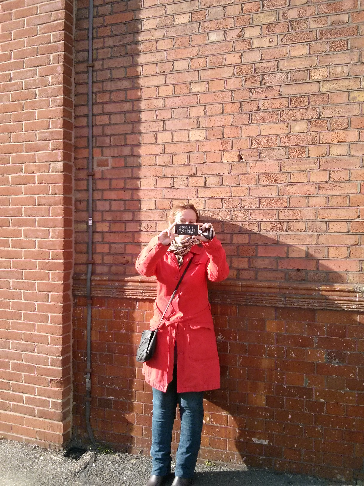
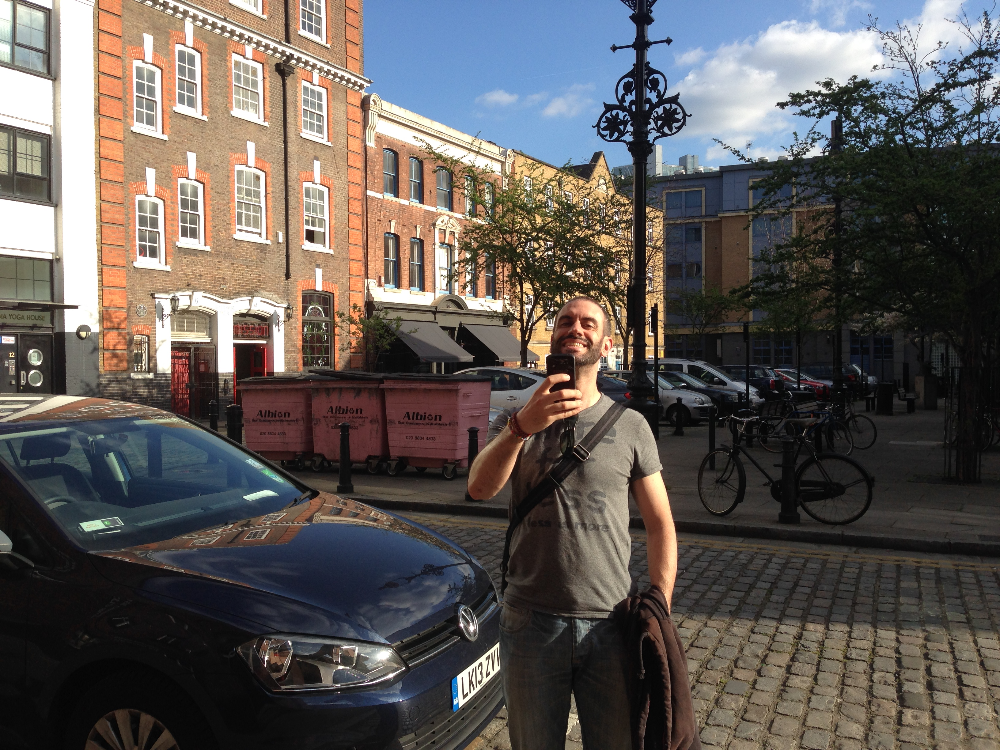
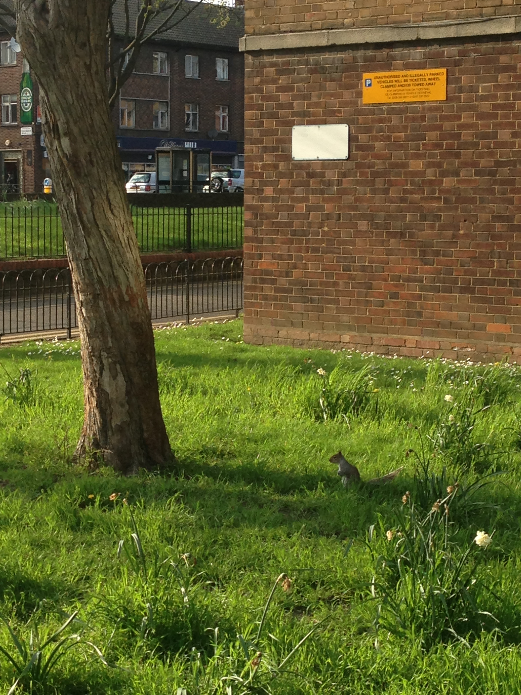
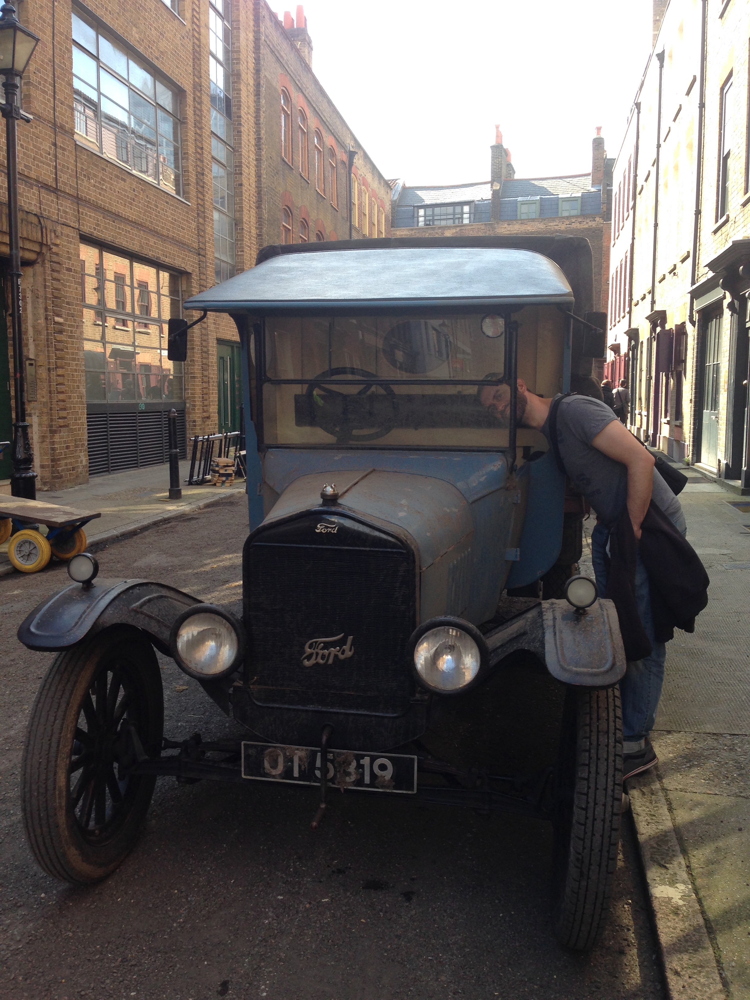
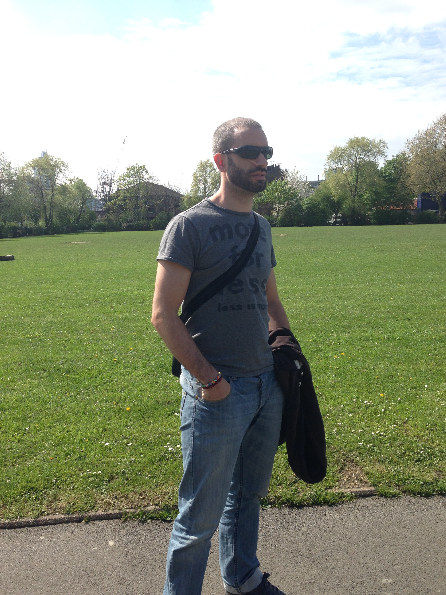
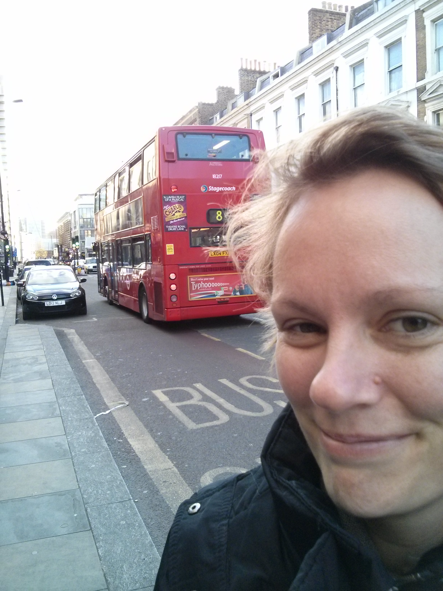
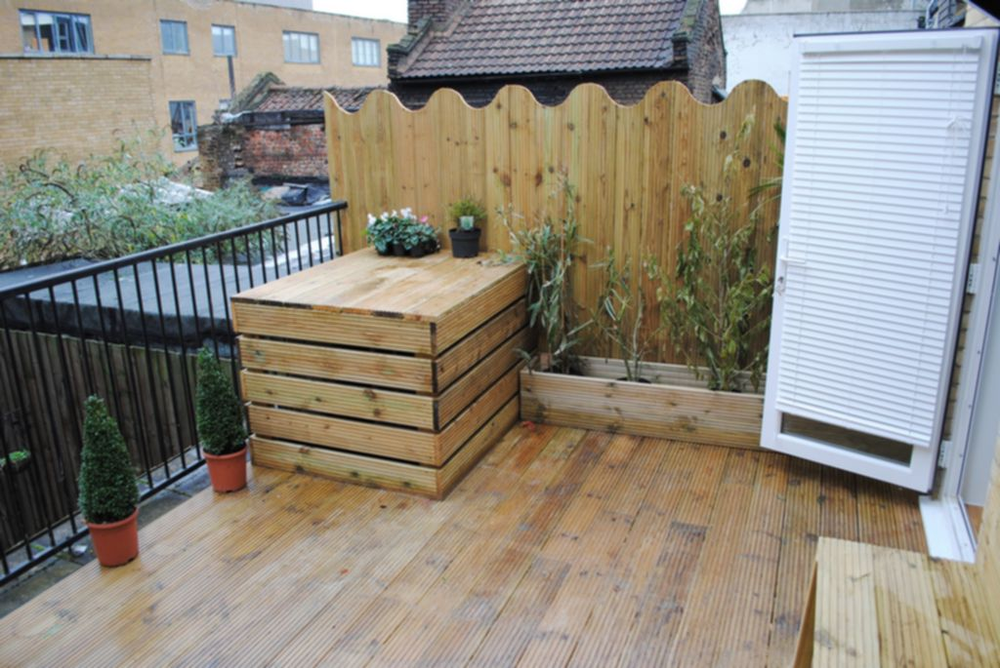
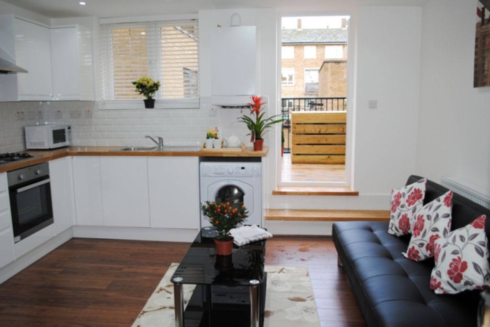
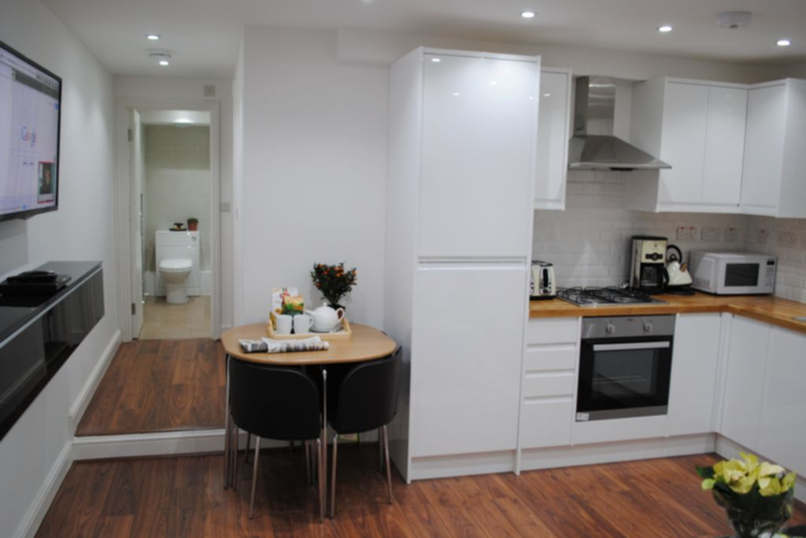

Hello everybody (probably nobody ;P),

Here we are again! As you may know the initial purpose of this blog was to explain what I experienced during my stay at London, which finally was shorter than I expected. But now I am at London again and I thought that would make sense to start explaining things from here, let's see how long do I stay this time ;)

This time I came not alone, thanks @[nmoraesmunter](https://twitter.com/nmoraesmunter) for sharing the full experience! Now we have been here for 2-3 days, and they have been really exciting. So let's explain a little bit.

## The flight

We do have a good flight to go to London, in fact as we knew that we would need to bring lot of stuff we booked one flight with British Airways and we find a good one which leave us at [Heathrow](http://www.heathrowairport.com/es) at 22:30, with plenty of time to arrive to Ana's home before she went to sleep.

When my parents took us to the airport my father already told me that there was something strange with fog at the airport surroundings. This was strange because we already had some contradictory messages telling us that the flight could be delayed, but AENA's one says that was not, so went to the airport as usual. When we check our baggage our worse expectations get confirmed: about 3 hours delay! British Airways gave us something to drink and eat but we will arrive very very late to London :'(

The problem was the **fog,** how many times have you seen fog at Barcelona airport? Well seemed to be the way Barcelona wanted to say goodbye also.

Finally we said goodbye to my parents (kind of a drama there) and went to wait the flight time. And at this point a guy just popup and told us that was also lost with the airplane delay and wanted to share the taxi to London. Finally turn out to be a very kind english IT guy :P... we spoke for all the time we were waiting and he explained us lot about London, thanks kody!

Then the flight arrived, a bit earlier than expected but was already 1 am in the morning. And as we are near Easter, we were not flying alone, in fact there was a school: like 20-30 adolescents crying at 1-2 am ... and still have to suffer the flight and then get to Ana's home. But we were very happy that finally started the trip:

 

At the flight we just slept most of the time, waking up just to eat something that British Airways give us without charge :D

 

## The mini-cab

Once we arrived the baggage reclaim was lightning fast and we were outside like at 1:45 (London time). Then we was waiting for the mini-cab but they simply does not arrive. And by this time we had another passenger for our mini-cab, an Spanish teacher who was collected by Kody. And there we met also another Spanish guy who had obviously lost his connection so we offered some help and Kody help him to find a Taxi because at Heathrow we where hardly alone, no much people neither much transports, and to get an official one could have cost more than 100 £. So finally the teacher and the other guy shared a taxi (hope they arrived safe) and our taxi driver arrived with our names on a poster. By the way this taxi driver was a big awkward: driving really fast and hardly never replying our questions ... but we arrived safe!

The drive through London at night was beautiful and Kody just acts as a tourist guide. So finally we had had a extra fast tour of London at night and arrived Ana's home! We just thanks her and let her to sleep because was really late, more than 3 in the morning and she had to go to work and Natalie had an interview at 11 am

## The first days

This day Nat was really nervous because of the interview, but she managed really well to do it and we are still waiting for response. By this time I went to change some cash, I used this [guide](http://www.diariodeunlondinense.com/guia/como-ahorrar-cambio-euro-libra/) and went to Victoria Station. And when we both finished started to looking at some flats to rent. We had two flats for viewing but none of them appear. We were shocked that people at London was not formal enough, but we keep trying.

Next day (yesterday) we just started by toping up (charging money on something) Natalie's UK phone SIM which was kind of an Odyssey because Spanish were not accepted, so finally again Ana came to rescue us. Then we had like a lot of flats to view during this day and the day after. And walking to the first one we found an office: GreenLand. With a polish girl who show some apartments just in the same building which were less than our expected price and really nice ones! But we kept with out plan and visited some others. During the trip we took some photos :P (with an spectacular weather)

At the end of the day the first ones were clearly the best, so we went back. When we arrived some of them were already taken, but lucky us the one that we liked was not, so we got it!

And then we went with Ana and her cousin to watch a cinema (just for 3,5 £ at [Genesis cinema](http://www.genesiscinema.co.uk/)) to watch Noah.

## Our Flat

And finally we have a flat! Today we are going to pay deposit and so in order to secure it (as a normal rule they ask for 1-2 weeks to remove the property from the market, then 1 month in advance and 6 weeks for deposit). Here it is our new home!. And it has a nice terrace, so let's hope we can do some barbecue!

 

## Conclusion

When you have to find a new property in London decide what neighborhood you want to live, then find some agencies near the place and don't wait so much because of what Ana said: "this is a jungle!".
