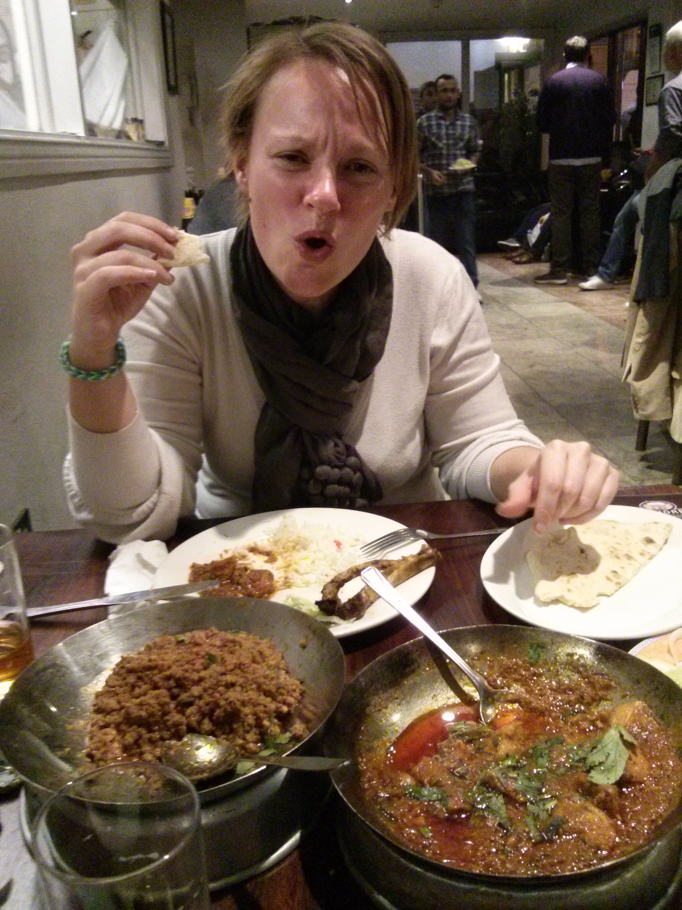
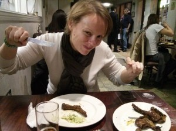

Hello Again (anybody)!

yesterday, after some more interviews and collecting mobile phone SIM cards (just in case you plan to come to Uk the best would have been to get a card from outside UK with http://giffgaff.com/, they can send it outside UK also) and so, we went to a nice restaurant.

This was again Ana's recommendation and was nice and fun.

The first thing that impress us was that there were large queues on this one but hardly nobody on the rest of restaurants, remember we were on the middle of the week so normally should not be that much people. We were lucky and just have to wait about 10 minutes, and in fact I think people does not wait that much but there where lot of people coming and there was always queue.

The restaurant is this: [http://www.lahore-kebabhouse.com/](http://www.lahore-kebabhouse.com/) and you can find some reviews [here](https://plus.google.com/114028664039953631027/about?gl=uk&hl=en).

One of the most curious things of the restaurant is that they do not sell alcohol but they let you came with yours, and everybody does! I was not sure about this and asked the waiter who confirm it. Then I went (twice :P) to the shop just near it where all the restaurant clients seems to go and grab some beer and cider for Natalie. The food was good and really spicy, there are some photos of the event:

 

 

 

 

 

 

 

 

 

 

The starters are really good, famous lamb chops and the rest also. Always try to get rise to counteract the spices. Finally we get 1 starter and 2 main courses with bread and rise and all of it for about £ 28, not very expensive of very cheap but the experience was really good, so we will recommend to at least try it if you come to London.
