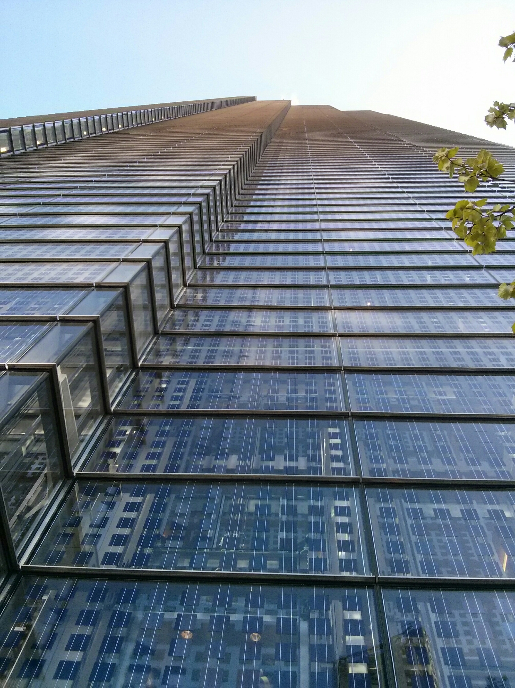
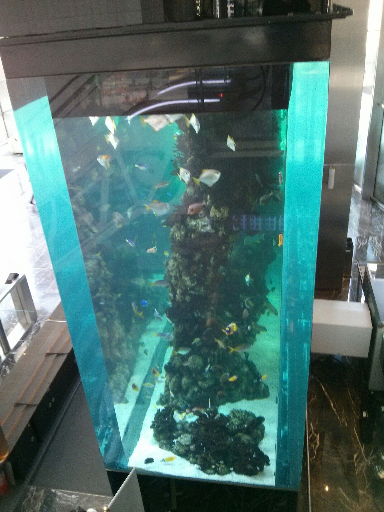
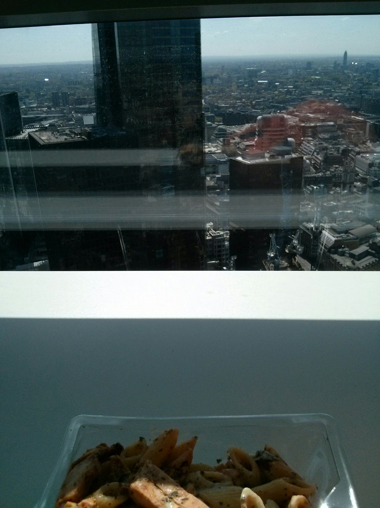
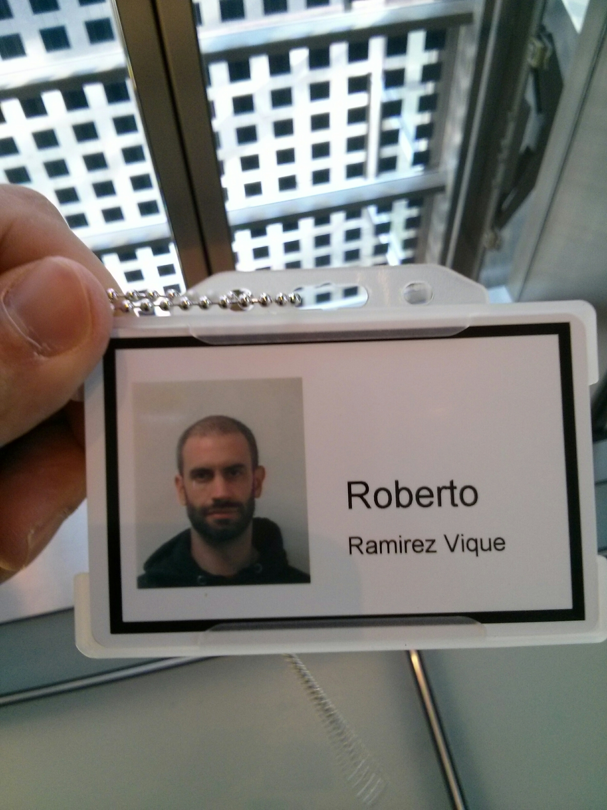
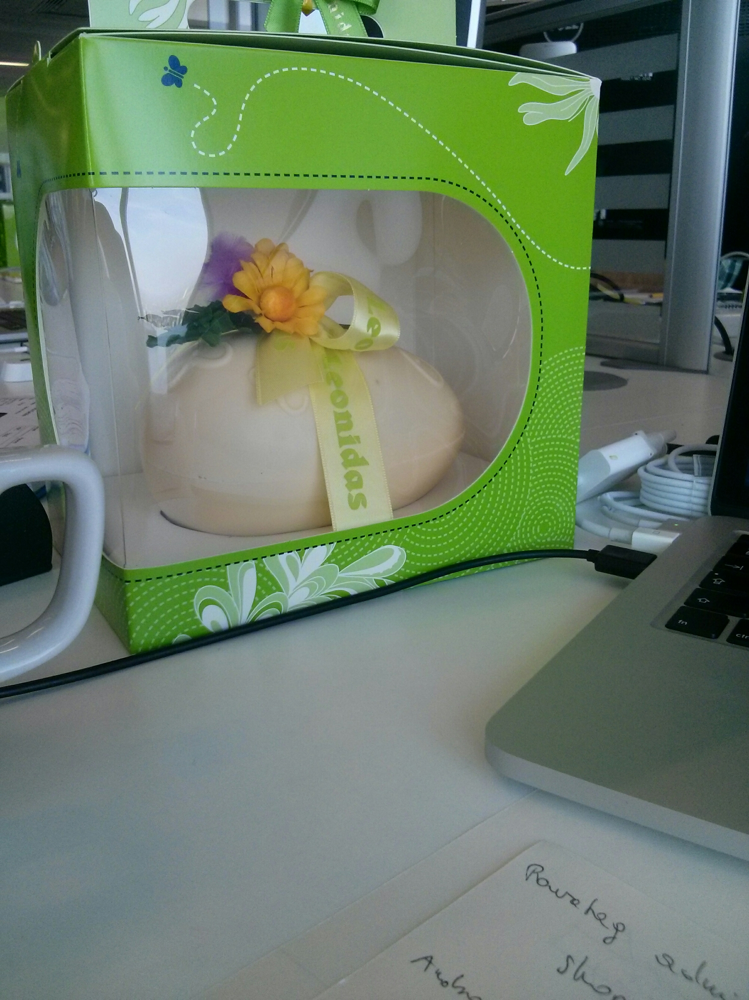
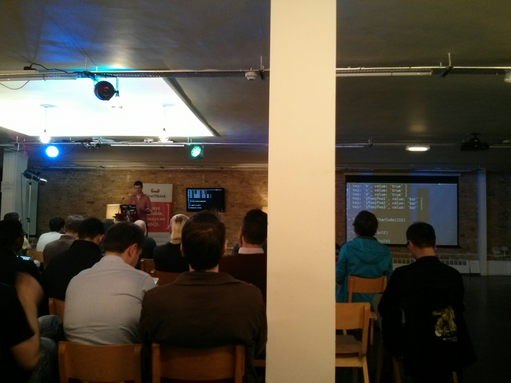
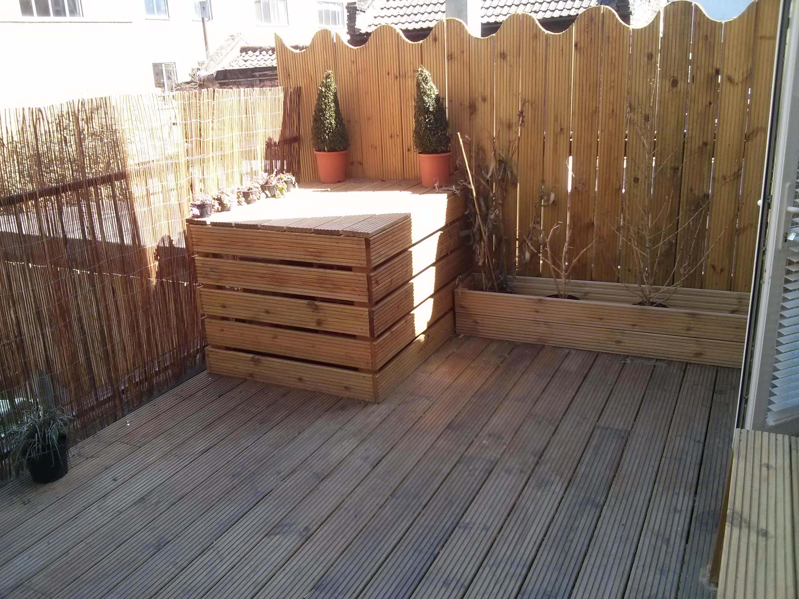
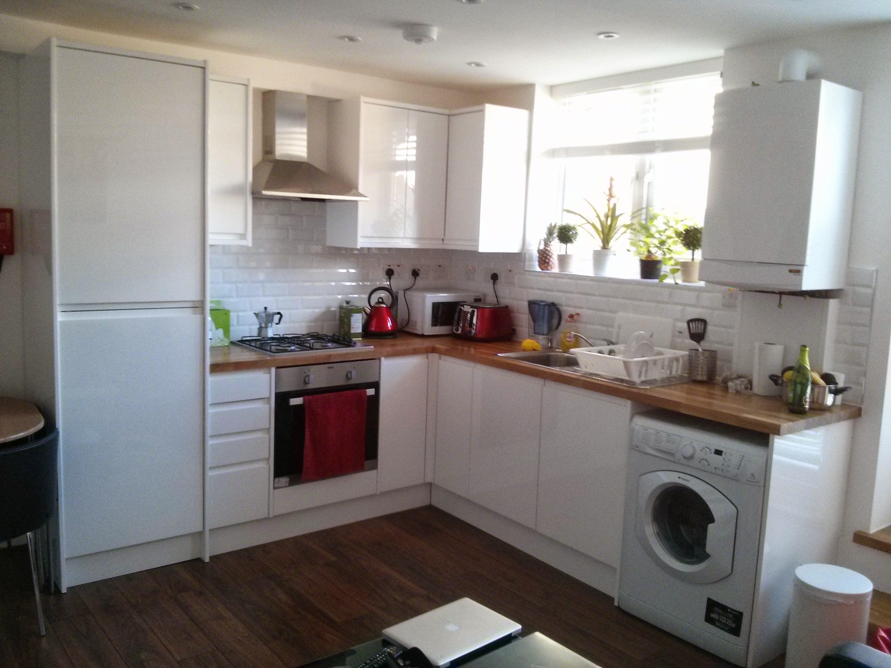
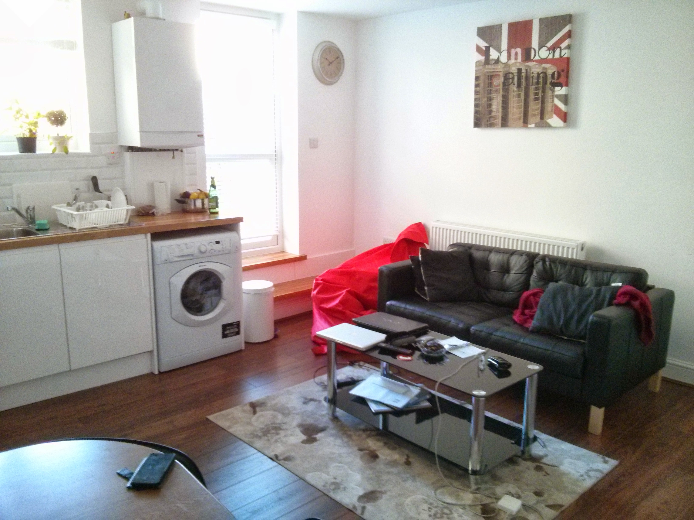
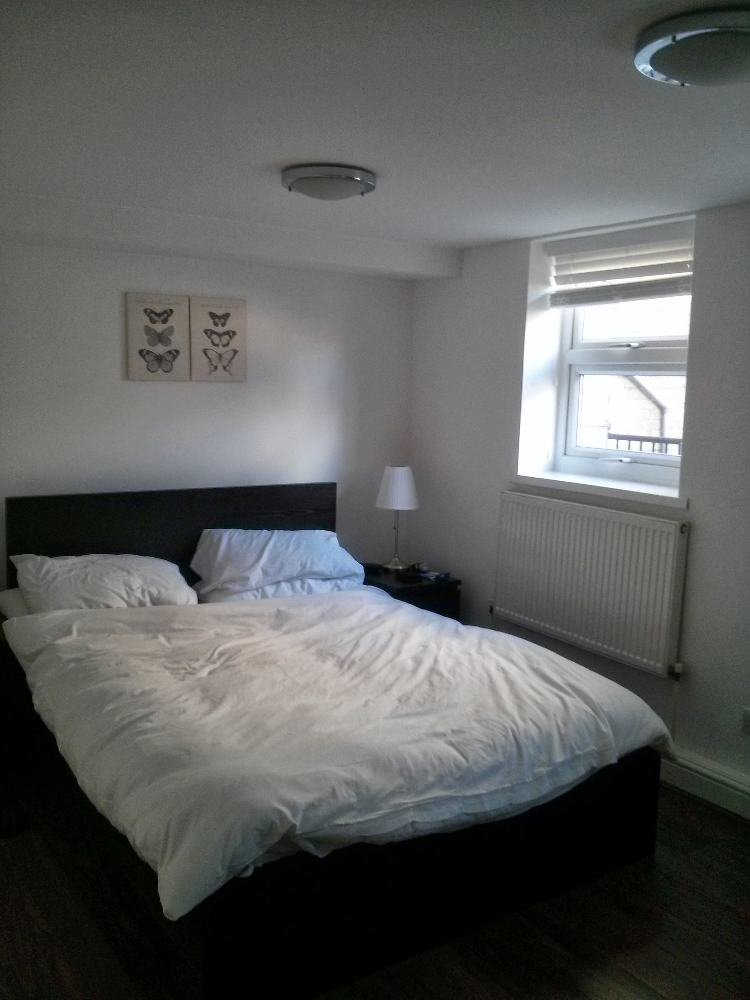

Here we go again! Sorry for the delay but we have been really busy this week, doing tons of things, and that's been just the first week.

On **Monday** we arrived to the new flat, some of you have already seen some pictures via Facebook but there are some

**Tuesday**: I started on the new job (incredible building named [Heron Tower](http://www.herontower.com/)) and really nice offices with my Mac book pro setup with 2 extra screens, cool isn't it? Natalie had different interviews, some of them she liked and are really near our home. There are some of the pictures of the new job, the first day I got an easter egg :D. And i went to a [meetup](http://www.meetup.com/London-NoSQL-and-Big-Data/events/173069182/) which explained leveldb, a google nosql db mainly in memory.

By Natalie's request, here it is the video of the glass based elevator which goes from the 34th floor to the ground floor in less than a minute:

https://www.youtube.com/watch?v=PArH7UrzvLU&feature=youtu.be

**Wednesday**: I went to job by bike! Using [barclays bikes](http://www.tfl.gov.uk/modes/cycling/barclays-cycle-hire), just 2 £ per 24 h. You can have also 7 days or all 90 £. And at the evening we went again to the Genesis Cinema to watch Spiderman 2 in 3D for 5,5 £ ... with our film critic Ana :

**Thursday**: Was pre easter, so just a normal work day but after it every body went to the pub! Except us, Natalie went to a salsa place named [Cuban school](http://cubanschool.info/)., and she did practice reggaeton and body isolation, she loved it! I went to my first Scala coding dojo, just went 6 people from the 70 that was supposed to came but was fun and people was very interested on new things. By the way on most of the IT meetups there is always pizza and drinks ... this time was pizza for 70 people to be shared between just 6 :P

**Friday**: Just relaxing day on our flat, also having fun with the puff we bough. At night we went to see Ana and have some fun on a proper english pub with Adai. Some new photos of the place:

The rest of the Easter we will do proper sightseeing at London. As you can see this days has been really busy and fun! Keep you posted.
