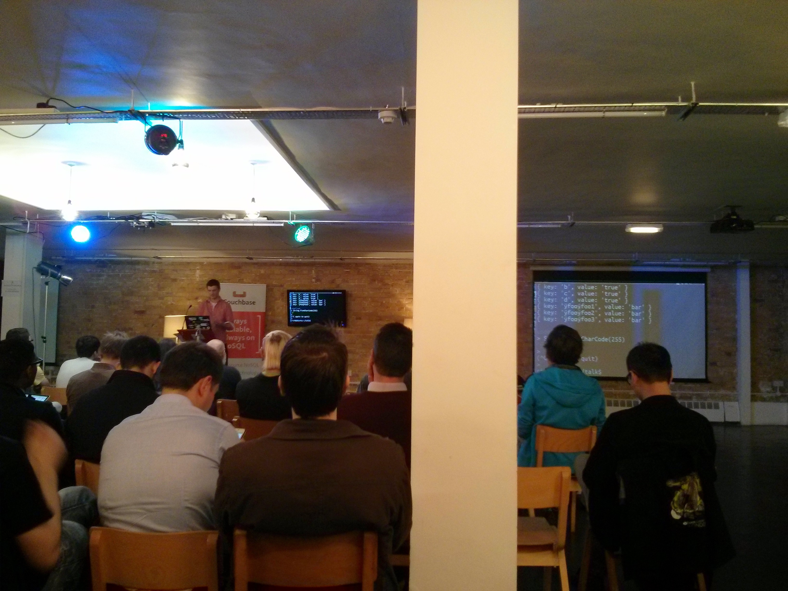
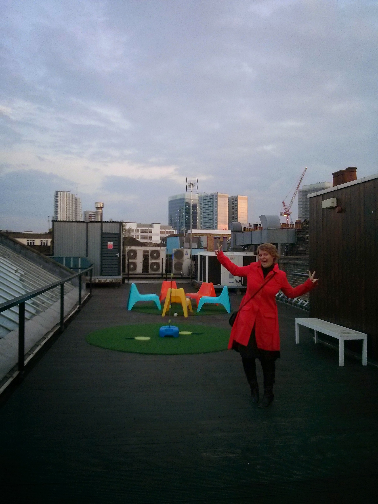
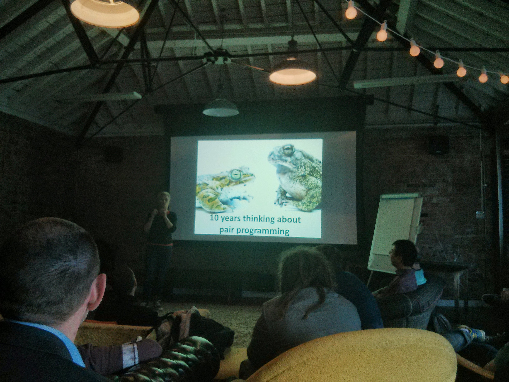
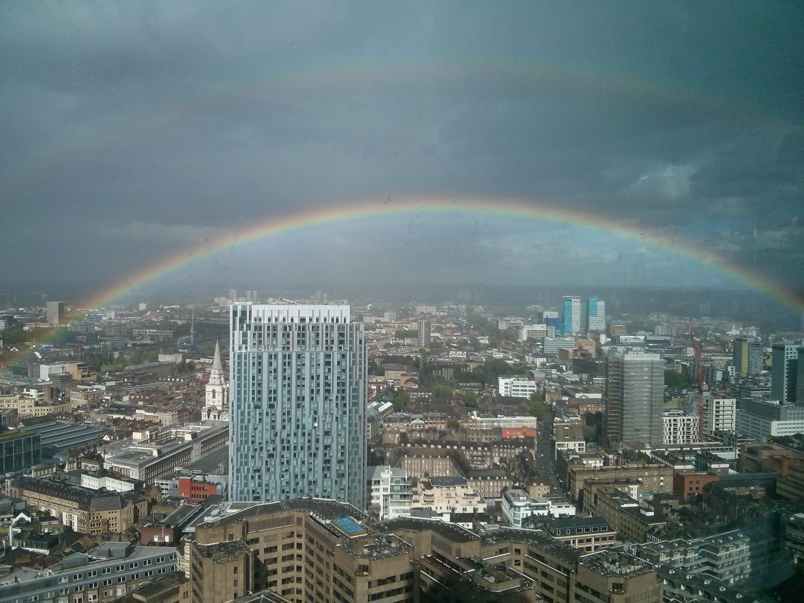

The last time I came to London (like 6 years ago) I discovered [meetup.com](http://www.meetup.com/) (probably there are other alternatives but this is quite known and used), and I started using it since then to find things to do, both in Barcelona and now in London. I think this is one of the easiest way to find out what is on your city (or any city you want to visit) and meet people as well.

The first days at London was a bit of crazy trying to find out the best ones and the point is that finally I realized that every day there is at least one thing to do, so I tried to keep doing every week but not getting crazy. Now I am on some interesting meetups that maybe any of you can enjoy:

- [Scala meetup](http://www.meetup.com/london-scala/): I just have gone to two of them but they keep doing things at least once a month and some dojos as well!
- [London Java Group](http://www.meetup.com/r/site/www/i3/card_row_count_4/http://www.meetup.com/Londonjavacommunity/): It's really active and with a lot of talks and dojos, some of them before work ... they call them coffee & code, isn't that awesome?
- [Squash](http://www.meetup.com/Squash-players-of-all-levels/) [meetups](http://www.meetup.com/londonsquash/). Obviously I have to go to some kind of sport and now my favorite one is squash (some day I will be good at this game ... maybe :D). The good point of this groups is that you can try any game they propose when they work for you, even some are free! Right now just tried once (and had another next week) but was really nice except for the fact that I am in really bad fit and I loose most of the games :P.
- [NoSQL London](http://www.meetup.com/London-NoSQL-and-Big-Data/): I have gone to two of their meetups, mostly talks about different technologies, last one at Google Campus (in fact is named like this but is just a normal London building).

There are others I joined and some are played at [SkillsMatters](https://skillsmatter.com/) which is even nicer because they [record](https://skillsmatter.com/skillscasts) all the talks that happen to be in there :D . You can find even developers groups for [specific](http://www.meetup.com/Italian-Developers-in-London/) [nations](http://www.meetup.com/Polish-Developers-in-London/). And I think Nat found that there are lot of groups for dancing [Salsa](http://www.meetup.com/Salsa-Classes-London/) and other [styles](http://www.meetup.com/bachatasalsalondon/).

There are some photos of events we have gone, there you can see that at most of them you can have food :P

 

Thanks to the London Java User Group and the London Scala User Group I know about [HackTheTower](http://www.hackthetower.co.uk/) which is a very nice monthly hack day organized by Salesforce's people at the same building I am working. And as the last photo for this post there is one that I took today on this hack day with a very nice double rainbow!

 

## Conclusion

Meeting people in the city is the best way to learn and be in contact with the city, and also helps with language (I hardly forgot, there are a lot of language exchange groups). In fact in cities like London you can find groups for mostly everything, so have a look and tell us what you find.
