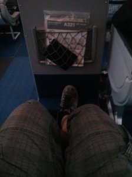
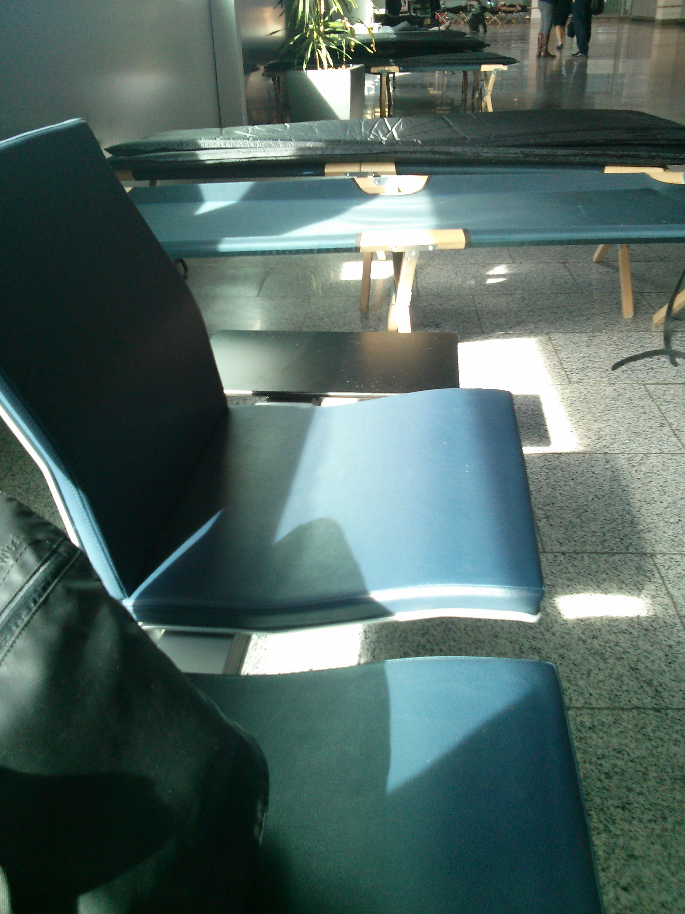
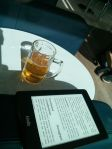

Hello everybody,

most of you already know but I did move again, this time a little bit further, to Seattle, USA :D (Natalie will came in some weeks, and sioux a little later).

My first time at the States, in fact the first time out of Europe at all. As usual I will start doing some posts but experiences tell me that it won't keep the same forever :D But being a totally different place with so many things to do and to explain and I didn't find a blog like [diariodeunlondinense](http://www.diariodeunlondinense.com/). So I'll try to give some tips (the few I find).

But let's start from the beginning:

# The trip

The flight was about 3 h from Barcelona to Frankfurt and 11 h from Frankfurt to Seattle. I started at 6 am arriving to the airports (thanks Nat, Mum and Dad for bringing me there). I was a bit nervous because I was not sure about the baggage and so, but finally there was no problem, like a normal flight to London but this time to Frankfurt. By the way I got a flight with [condor](http://www.condor.com/us/index.jsp) (first was with lufthansa and then condor itself). The first one was good, I got a really good emergency exist seat and there was some free breakfast during the plane.

Then I arrived to Frankfurt where I had to wait about 4 hours. This was also my first stopover flight so I don't know if is normal but by this time I had to go outside the security control and pass it again. During this trip I found that there were beds on the airport ... I assume this is a typical airport where people has to wait a lot so it is ready, what is kind of cool!

Then I went to the business lounge ... ah, maybe I forgot to tell you but was also my first time on business ... as it was my first long trip I decided to give me this luxury, which in fact was not so expensive because was less in condor than getting a normal flight with other well known airlines.

So being in the lounge at the airport is really different than being just waiting, there are food and good views of the airport, there is also drinks (as you can see just next) and good internet connection and electricity plugs for your gadgets. So I decided to relax a bit and get some "energy"!

And at that point I thought I will get normally the flight but this was the point to really present your documents, in my case with the visa in my passport was just enough. They asked me some data like where are you going to live, work and so, and that's it (this became the most bureaucratic part of the trip).

The long flight was good overall. A bit long for me but the cabin was really good, the crew super friendly and there was plenty of food. The main meal (they served us two) was really good to be in a flight, also with good wine. The second one was with some turbulence so was a bit more difficult to enjoy it. I slept about 1 hour (maybe too excited?) and watch two movies (no-brainer movies with some action :D). The flight was in a boing 767-300 where I can get 170 degrees on my seat, with a touch screen with quite a bit movies, so was not bad ... better being at home but more than acceptable.

# Arrival

At the arrival I was instructed to be one of the very first on [customs](http://en.wikipedia.org/wiki/Customs_airport), so I got not extra queue. I was a bit nervous because I suppose I will got some questions and maybe some problems (I am always the positive one, don't you notice?). I arrived probably one of the first, being in business does also helps there but there were people literally running to be some of the first because in the flight we where about 160 people and we assume there will be much more. But when we arrive we were alone in customs (and finally we were the only flight at the airport at this part of the airport ... so the aiport was really empty and calm).

The customs was really fast and nothing but easy the policeman talked with me in Spanish also which was fun. Just very few questions (where are you going to stay/work) and I got the required stamp. Then wait for the luggage and end up giving a form telling what I have to declare: nothing :D

And I was ready to go! And arrived to Seattle :P

In fact I was in the Tacoma airport, not at home yet. To get to Seattle I looked around and there are [shuttles](http://shuttleexpress.com/) (like taxis) that you can take to go anywhere from the airport and you can even share the transport so will be cheaper (around $30-40). But I though that I was not in a hurry so I wanted to took the public transport, so I did.

The first thing I did was get my [orca](https://www.orcacard.com/), which is equivalent to the oyster. There was nobody to help me but a machine (in fact there was a American man who had problems and I helped him ... my very first good deed). It was easy, especially compared with London or Barcelona, just some clicks. But I missed the place to touch in (orca is an RFID card so contact free but there is no control to avoid you enter, at least on the light train I took there) before going to catch the train in the upper floor, so I made a bit more exercise with my huge suitcase but was fine. After the train I took the bus, where I was a bit lost 'cause don't even had an idea where to stop but the signs people in the house gave to me was pretty clear (and google maps also helped a bit), so finally I got to the place ... a bit exhausted but all right. By the way the price of each ticket was about $2-$3, now that I took it regularly is about $2.25-2.5 (depending on the peek hour).

# End of the day

Finally I got to say hello to people in the house, they are super friendly and are helping me a lot. They also told me where to get some food and I went to buy something to the supermarket ... and as the day was really long and I had sinned ... I got a burger at [wendy's](https://www.wendys.com/). Then buy some food and go to sleep! (like I will do when I publish this loooong post).

 

I think this is enough for now, but keep tuned and I will try to post some other stuff ... because this first days I started doing some tourist! I am getting ready for people coming to visit us :D
