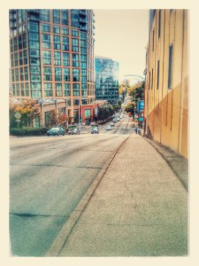
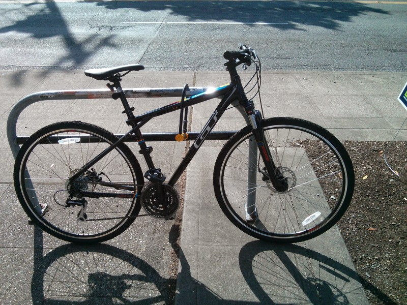
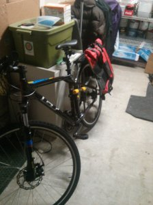
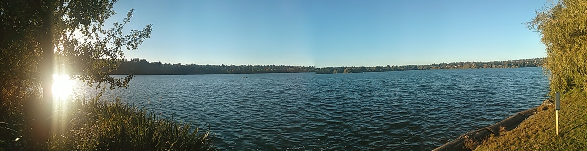
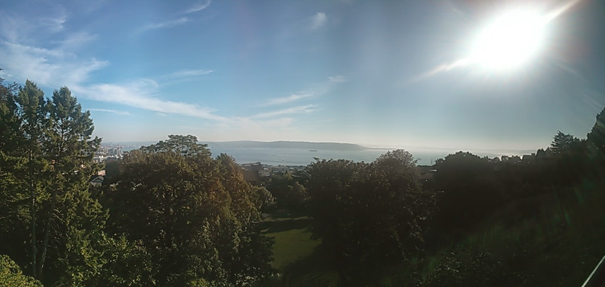
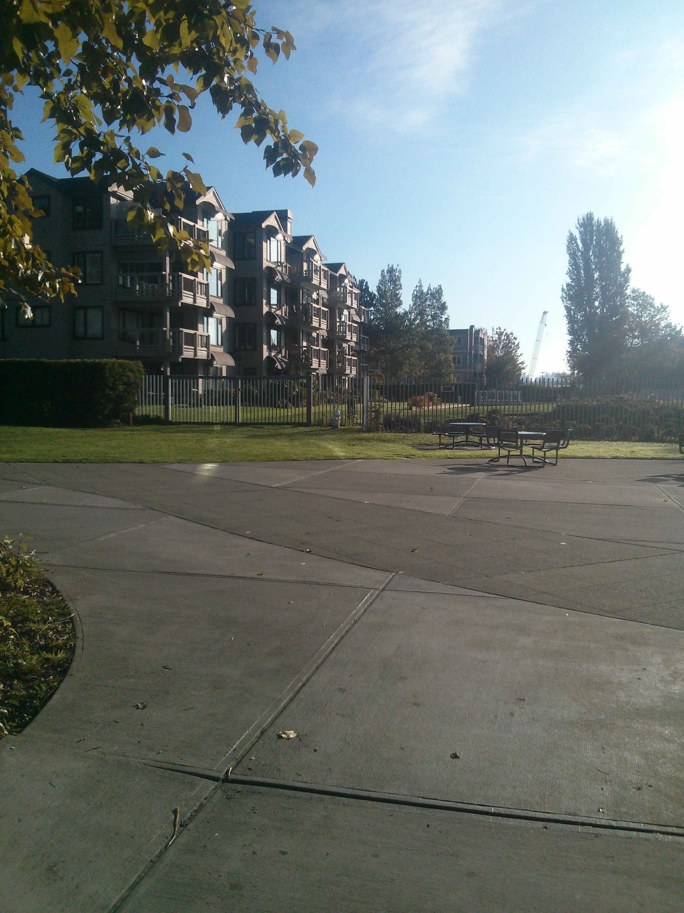
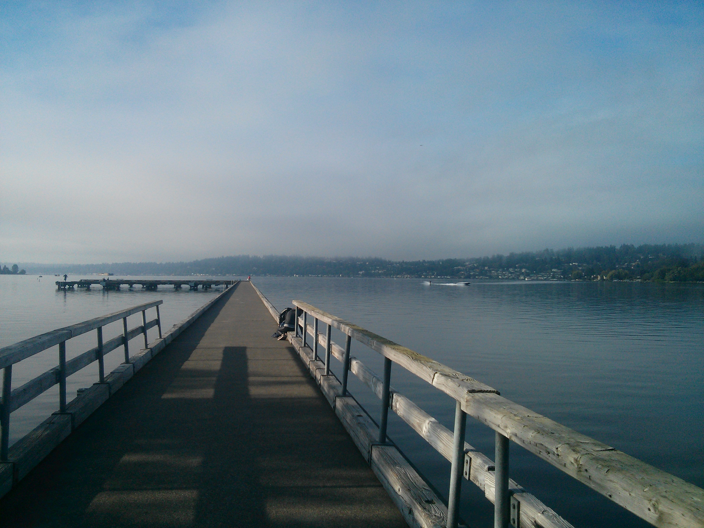
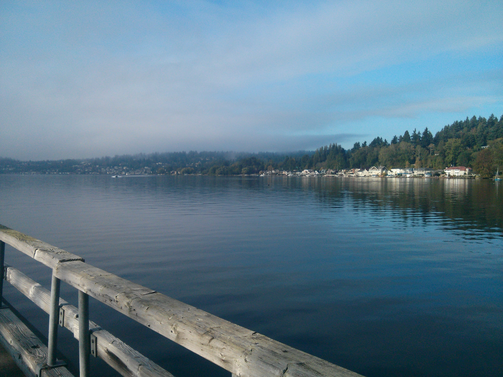
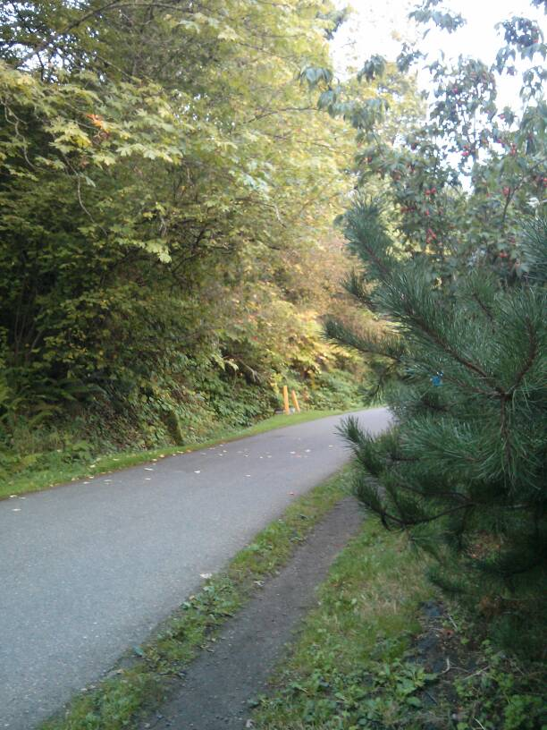

Yes, I have to admit I finally got it! I can say I am a bike commuter. Long time I said that I wanted to be, so finally I am a bike commuter on US ... sounds strange, isn't it? Well, turns out that is really common at least in Seattle to be a bike commuter even with the rain. But let's start from the beginning.

# Buy the baby

Always is complex to get something you are waiting for, specially when there are lot of options ... and in terms of bikes there are a lot of options!

First, lets evaluate kind of bikes:

- _Mountain bike_. As its name points out, is a bike for the mountain ... It is not going to be my case, so --> Discarded! Mainly because is not so efficient.
- _Road bike_. Again, is a bike for the road. They are much faster and efficient than the rest, but a bit less comfortable ... finally I also discarded this one but I have to say that is a really good option for commuting, I have seen quite a lot and also seems a really good option.
- _Fixies_. Are fixed-gear or what is the same you cannot stop pedaling while riding a bike like this. Most of them are also with just one gear. Seattle has a lot of hills (see the photo on the right :P), not hard but enough to discard also this option.
- _Hybrid bike_. This is between mountain bike and a road bike. Some of them has suspension which makes really comfortable the drive experience and normally they have special tires to be faster. And as this is the last option, yes ... this is the kind of bike I bought. Mainly because it is easier to commute with a non regular roads but efficient enough to enjoy the city.

## Do I want to be the first riding this horse?

Always there is the option of second hand bikes, they are pretty good. Also there are good places in Seattle, like [play it again](http://www.playitagainsportsdtseattle.com/), or  [recycled bikes](http://www.recycledcycles.com/). But to be fair the second hand prices are not so low, even-though there are good options. As always this alternative requires time to get the proper bike. So finally I just went around to try to find the correct bike and found it in a bike shop ... so there she was!

## Where were you all this years?

In [performance bikes](http://www.performancebike.com/). There are some shops in Seattle. The shop I went was near the University district. Was good because they give me the option to test some of the bikes inside the shop, and when I tried mine was like ... there you are! It has also disk brakes which I tried in Barcelona and are really awesome plus gives you lot of security. So finally here she is:

As you can see she is very nice looking! And very comfortable to ride, in fact I got surprised that didn't hurt my a... :P ... But the saddle was really good and I don't need any extra, not like the one I had in Barcelona.

In dimensions it is a medium frame with 700c wheels, which is similar to the 29 inches.

Price of the bike: $450 + taxes

# My baby has lot of friends

Yes, I need to get lot of complements for my bike ... lot of them! And you need most of them if you want to commute.

- First of all when I got the bike the sell me also a **helmet** and a **U lock**. I need them because I was going to a dinner so I got them ... then I realized that maybe was not the best but they were good enough.
    - I bought an [extension for the lock](http://www.amazon.com/gp/product/B000NORUJW/ref=oh_aui_detailpage_o07_s00?ie=UTF8&psc=1) ... right now I have never used it, but makes me feel more secure in case I have to leave the bike for long time. And the brand is cool: Kryptonite.
- Another important thing, which is mandatory by law, is the **lights** ... the first night I didn't have and some friends lend me two small ones and I understood why I need one, not just because of the law but because some streets at night are completely dark. So I went to amazon and bought a [pair](http://www.amazon.com/gp/product/B00KM01XEA/ref=oh_aui_detailpage_o07_s00?ie=UTF8&psc=1) of lights. they are not incredible lights but good enough. I also bought a [simpler ones](http://www.amazon.com/gp/product/B00KVZJOPG/ref=oh_aui_detailpage_o05_s00?ie=UTF8&psc=1) in case of emergency or as simple extras.
- a [rain jacket](http://www.amazon.com/gp/product/B00BH7JUGK/ref=oh_aui_detailpage_o00_s00?ie=UTF8&psc=1) days (I already used and just arrived two days ago :P). This one is good because you can remove the sleeves and has some pockets and some ventilation.
- a [rack](https://www.performancebike.com/bikes/ProductDisplay?langId=-1&storeId=10052&catalogId=10551&productId=1088406&summaryOnly=true) to carry bags and panniers.
- And a [pannier](http://www.amazon.com/gp/product/B00FNSS92A/ref=oh_aui_detailpage_o02_s00?ie=UTF8&psc=1), water resist and can be converted to a messenger bag and can carry a laptop.

So finally this is the current aspect of the baby:

## Friends who we eventually meet

- At some point I have to buy a waterproof trousers in case there is more rain and colder weather, which eventually can happen :P
- a bottle for water or any liquid.
- Maybe another pannier, in case I really need it ... but right now I think I have enough space.
- Some tools to fix the bike, but I bought an special card on the place I went that they will fix the bike in case of a flat and also tune her twice in two years, so maybe don't need them now.
- Water protection glasses ... at least the last time was really raining I got lot of water on the eyes and I would have appreciated a glasses.
- Front and back fender, the same day with the rain on my eyes I realized I will need this also.

# The routes

Going to work on Seattle is really easy, there are some routes where you are totally safe because there is a lane, but on other roads there are signs where you should stay and cars generally respect you.

In case you are interested this is the normal route I take every day (well, almost every day) to go to work ... about 20-25 mins and 5 kms (3 miles)

 

\[googlemaps https://www.google.com/maps/embed?pb=!1m29!1m12!1m3!1d21521.588948224467!2d-122.34365714503363!3d47.602827499912664!2m3!1f0!2f0!3f0!3m2!1i1024!2i768!4f13.1!4m14!1i0!3e1!4m5!1s0x54906a92279b0ec1%3A0xa89ba9230d47eb93!2s1701+S+Atlantic+St%2C+Seattle%2C+WA+98144%2C+USA!3m2!1d47.589873!2d-122.31028599999999!4m5!1s0x5490154a6062c1b7%3A0x78ca7e1889b2fc38!2s1918+8th+Ave%2C+Seattle%2C+WA+98101%2C+USA!3m2!1d47.6156863!2d-122.3359777!5e0!3m2!1sen!2sus!4v1414135868243&w=600&h=450\]

I also did one of the first days which is named [burke-gilman](http://www.burkegilmantrail.org/) trail. Is really good and pretty easy, to me the worst was to arrive there ... and the views are spectacular (as most of Seattle landscapes).

